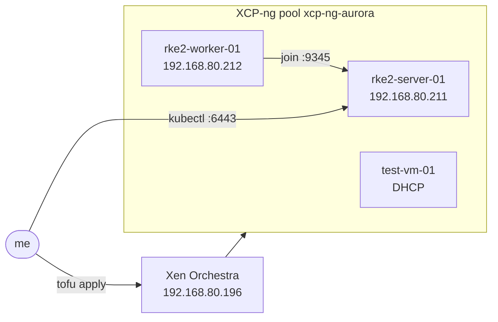
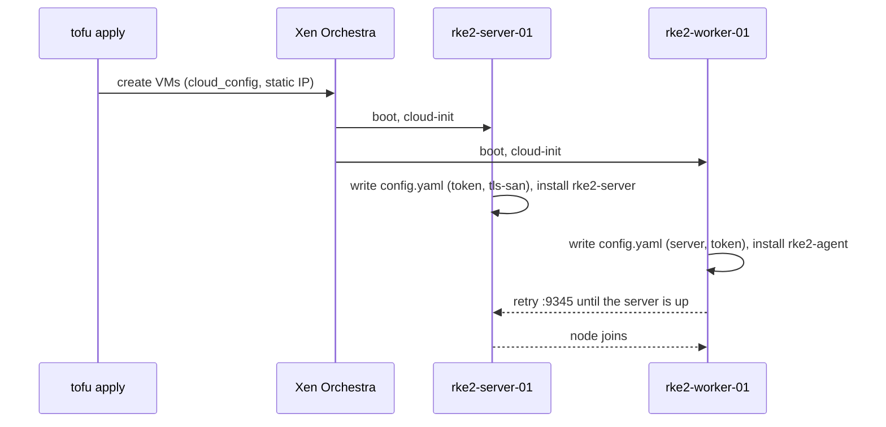
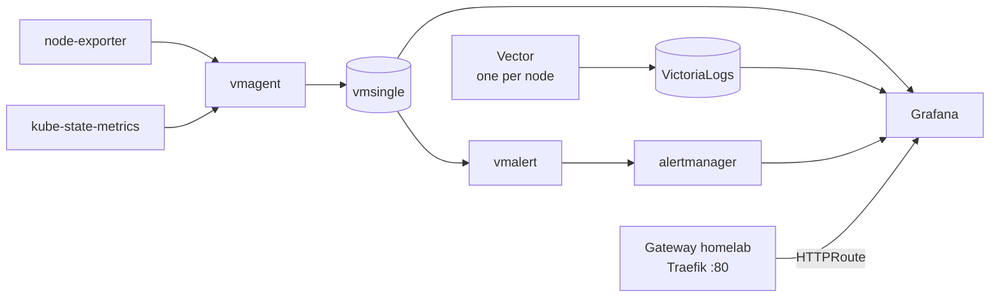

# RKE2 cluster and monitoring

Two XCP-ng VMs running RKE2, created with OpenTofu, plus a VictoriaMetrics monitoring stack installed with Helm.

## What is here

| Thing            | Where                                      |
| ---------------- | ------------------------------------------ |
| VMs (OpenTofu)   | [gitops/tofu/](../gitops/tofu/)            |
| Monitoring chart | [charts/vmstack/](../charts/vmstack/)      |
| Xen Orchestra    | `wss://192.168.80.196`                     |
| Pool             | `xcp-ng-aurora`                            |

| Node           | IP             | Role                | Size           |
| -------------- | -------------- | ------------------- | -------------- |
| rke2-server-01 | 192.168.80.211 | control-plane, etcd | 4 CPU, 8G, 40G |
| rke2-worker-01 | 192.168.80.212 | agent               | 2 CPU, 4G, 40G |
| test-vm-01     | DHCP           | scratch VM          | 2 CPU, 4G, 20G |

Static IPs are set through `cloud_network_config`, gateway and DNS are `192.168.80.1`. They sit outside the router's DHCP pool.



## VMs with OpenTofu

Everything is driven by the `vms` map in `terraform.tfvars` (gitignored, it holds the RKE2 token). The module in `modules/xoa-vm` is not touched, per-VM differences go in `cloud_config` and `cloud_network_config` only.

```shell
cd gitops/tofu
export XOA_TOKEN=<token>   # XOA: User -> Authentication tokens
unset XOA_USER XOA_PASSWORD
tofu plan
tofu apply
```

Use a token, not user and password. The password login was rejected (`invalid credentials`) and having both set makes it unclear which one wins.

Changing `cloud_config` or `cloud_network_config` of an existing VM replaces it. cloud-init only runs on first boot.

## RKE2

Installed by cloud-init (`runcmd`, quickstart method). The server and worker share a token written to `/etc/rancher/rke2/config.yaml` by cloud-init. The worker joins `https://192.168.80.211:9345`. The server's `tls-san` has both the IP and the hostname.



Why static IPs: the router does not register DHCP hostnames in DNS, so the worker could not resolve `rke2-server-01` and never joined. The module cannot hand one VM's IP to another, so the server needs a known address.

Takes a few minutes after boot. Check on the server:

```shell
ssh ubuntu@192.168.80.211
sudo /var/lib/rancher/rke2/bin/kubectl --kubeconfig /etc/rancher/rke2/rke2.yaml get nodes
```

### kubeconfig

```shell
ssh ubuntu@192.168.80.211 'sudo cat /etc/rancher/rke2/rke2.yaml' \
  | sed 's#https://127.0.0.1:6443#https://192.168.80.211:6443#' > ~/.kube/rke2-homelab.yaml
chmod 600 ~/.kube/rke2-homelab.yaml
export KUBECONFIG=~/.kube/rke2-homelab.yaml
```

## Monitoring: vmstack

Umbrella Helm chart over two upstream charts (versions in `Chart.yaml`):

- `victoria-metrics-k8s-stack`: vmsingle (14d), vmagent, vmalert, alertmanager, Grafana, node-exporter, kube-state-metrics
- `victoria-logs-single` with Vector collecting container logs

[templates/grafana-datasource-logs.yaml](../charts/vmstack/templates/grafana-datasource-logs.yaml) adds the VictoriaLogs datasource to Grafana, the stack's own `additionalDataSources` did nothing.



### Install or upgrade

The release must be called `vmstack` (the logs service name depends on it).

```shell
kubectl create namespace monitoring
kubectl -n monitoring create secret generic grafana-admin \
  --from-literal=admin-user=admin --from-literal=admin-password=<pw>
cd charts/vmstack
helm dependency build
helm upgrade --install vmstack . -n monitoring
```

### Grafana

- URL: `http://grafana.192.168.80.212.nip.io` (Gateway API, see below)
- User: `admin`, password in `~/.kube/grafana-admin-password` and the `grafana-admin` secret
- `nip.io` is a public wildcard DNS service: the name resolves to the IP inside it. It needs internet DNS and is plain HTTP. Replace with a real name in `values.yaml` (`grafanaRoute.host`) when there is one.

### Gateway API

Traefik's Gateway provider is enabled by [traefik-helmchartconfig.yaml](../gitops/rke2/traefik-helmchartconfig.yaml), which creates the `traefik` GatewayClass. The shared `homelab` Gateway ([gateway.yaml](../gitops/rke2/gateway.yaml), `kube-system`, listener port 8000 = Traefik's `web` entrypoint) accepts routes from all namespaces. The chart's `HTTPRoute` points at it. Apply both manifests before installing `vmstack`:

```shell
kubectl apply -f gitops/rke2/traefik-helmchartconfig.yaml   # restarts Traefik
kubectl wait --for=condition=Accepted gatewayclass/traefik
kubectl apply -f gitops/rke2/gateway.yaml
```

New apps: add an `HTTPRoute` with `parentRefs` to `homelab` in `kube-system`. HTTP only for now, no TLS listener.

## Gotchas

- **No StorageClass.** RKE2 ships none. vmsingle, VictoriaLogs and Grafana use `emptyDir`, so data is lost when a pod restarts. Needs a provisioner (local-path or Longhorn) before this is real.
- Dashboards and alert rules are downloaded from GitHub by a sync Job at install time, and Grafana downloads the logs plugin on start. Needs internet.
- etcd, scheduler, controller-manager and kube-proxy scrapes are disabled, they are not reachable the kubeadm way on RKE2.
- `192.168.80.202` is used by something else on the LAN. Check with `ping` and `ip neigh` before picking an address.

## TODO

- [ ] Storage provisioner, then turn persistence back on in `values.yaml`
- [ ] Real hostname and TLS for Grafana
- [ ] Alertmanager receivers (nothing is notified yet)
- [ ] Remove `test-vm-01` from `terraform.tfvars` if not needed
- [ ] Remote tofu state, it is local (`terraform.tfstate`) and gitignored
