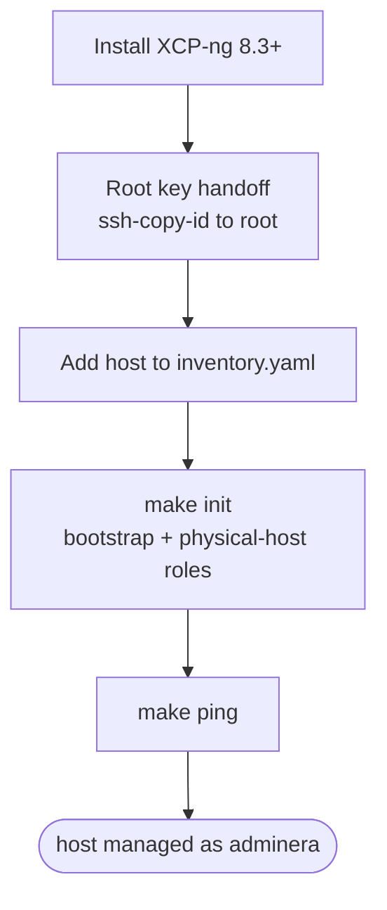

# Virtualization environment

## Adding a new XCP-ng node



### Checklist

- [ ] Install XCP-ng **8.3 LTS or newer** on the hardware
- [ ] Set a root password during the installer
- [ ] Note the host's IP (static or DHCP reservation)
- [ ] Copy the adminera key to root for the one-time bootstrap
- [ ] Add the host to [inventory.yaml](../ansible/inventory.yaml)
- [ ] Run `make init`
- [ ] Run `make ping` to confirm

### Why 8.3, not 8.2

XCP-ng 8.2's dom0 only ships Python 2.7 (CentOS 7 base, no `python3` package anywhere). The `ansible-core` version this repo's tooling uses has fully dropped Python 2 target support — module execution fails with a `SyntaxError` in the generated wrapper, and no `ansible_python_interpreter` override fixes it. XCP-ng 8.3 ported dom0's own Python tooling to Python 3, so it ships a working `python3` and the [bootstrap and physical-host roles](../ansible/roles/) work against it without any workarounds. If a host ever turns out to only have Python 2.7, reinstall it on 8.3+ rather than chasing interpreter fixes.

### Install XCP-ng

Burn the 8.3 (or newer) ISO, boot the hardware from it, and follow the installer. Set a root password you can type once — it's only needed for the initial key handoff below, nothing stores it afterwards.

### One-time root key handoff

A freshly installed host only has `root`, authenticated by the password you just set — there's no `adminera` user yet, and no SSH key is authorized for root. The [bootstrap role](../ansible/roles/bootstrap/) needs *some* key-based way in to create `adminera`, so copy its key to root once, interactively:

```shell
ssh-copy-id -i ~/.ssh/boleadoras.pem.pub root@<host-ip>
```

This prompts for the root password from the installer. After this, the bootstrap play can connect as root using the same key everything else uses.

### Add the host to inventory

Edit [inventory.yaml](../ansible/inventory.yaml) and add the host under the `xcp-ng` group, next to the existing ones:

```yaml
xcp-ng:
  vars:
    ansible_user: adminera
    ansible_ssh_private_key_file: ~/.ssh/boleadoras.pem
  hosts:
    aurora:
      ansible_host: 192.168.80.213
    <new-host-name>:
      ansible_host: <new-host-ip>
```

### Bootstrap and verify

```shell
make init   # bootstrap role (root): creates adminera, deploys its key, grants NOPASSWD sudo
            # physical-host role (adminera): ensures sshd is enabled and running
make ping   # confirms adminera can reach every host in inventory.yaml
```

After this, the host behaves like every other node: `ansible_user: adminera` from inventory, root access via sudo, no more need for the install-time root password.

### Troubleshooting

#### SSH host key warning after a reinstall

If the host's IP was reused (reinstall, DHCP reassignment to a different box), SSH will refuse to connect with a "REMOTE HOST IDENTIFICATION HAS CHANGED" warning. Confirm it's actually the host you expect (compare `ssh-keyscan <ip>` against the `known_hosts` entry — a different OS/OpenSSH banner means a different machine is sitting at that IP), then:

```shell
ssh-keygen -R <host-ip>
```

#### `Permission denied (publickey,password)` as adminera

Expected on a host that hasn't been bootstrapped yet — `make init` hasn't run there. Do the root key handoff above, then `make init`.
